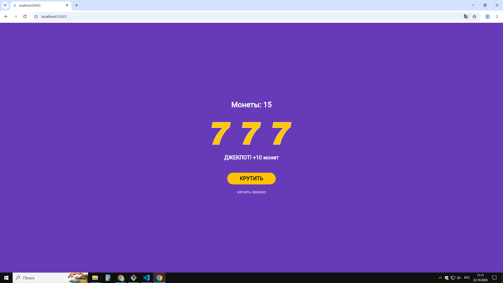

# Лабораторная работа №9. Flutter: StatefulWidget и управление состоянием
## Выполнил:
Лазарев Иван ИСП-242 
## дата сдачи 
22.10.2026
***
изучил разницу между StatelessWidget и StatefulWidget, научился
управлять состоянием приложения через setState(), подключать локальные
изображения и обрабатывать нажатия кнопок — на примере слот-машины.
***
## Запуск
1. `git clone <url>`
2. `cd Flutter_Lab09_Lazarev`
3. `flutter pub get`
4. `flutter run -d chrome`

## Скриншот
